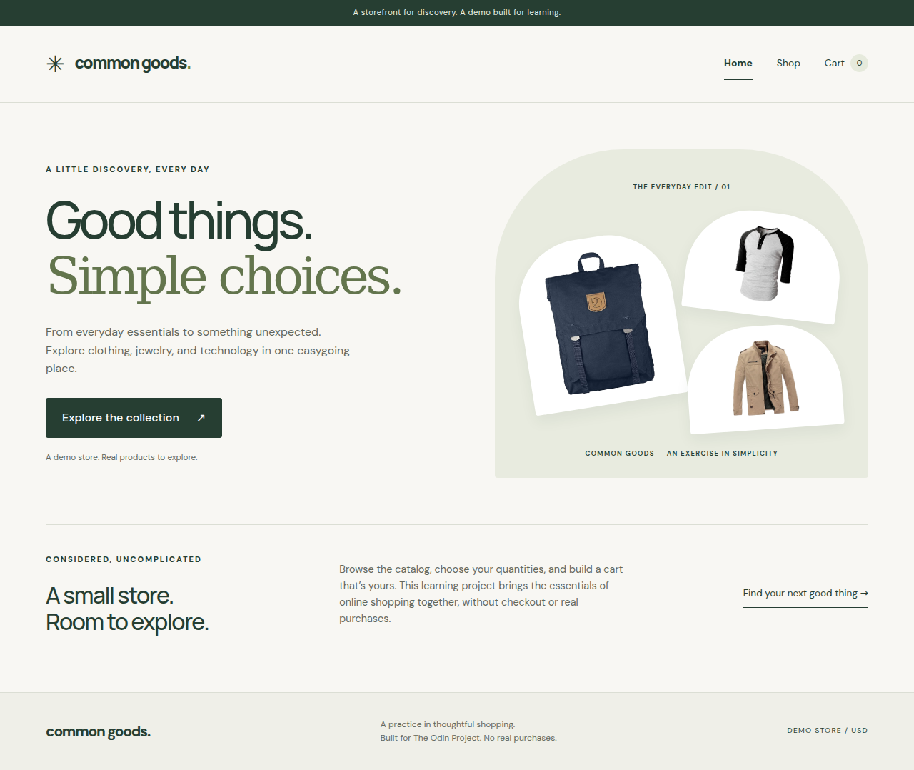

# Common Goods

A responsive React storefront with API-powered products, client-side routing, and an interactive shopping cart, built for [The Odin Project Shopping Cart assignment](https://www.theodinproject.com/lessons/node-path-react-new-shopping-cart).



## Features

- Home, Shop, Cart, and a helpful not-found page with shared navigation.
- Live product information and images from [Fake Store API](https://fakestoreapi.com/), with loading, error/retry, empty, and unavailable-image states.
- Editable quantities, increment/decrement controls, merged repeated additions, removal, and a navigation badge showing the total item quantity.
- Integer-cent price calculations and derived line subtotals and order totals, displayed in USD.
- Responsive CSS Modules, keyboard focus indicators, associated input labels, route titles, a skip link, and polite add-to-cart feedback.

## Run locally

Use Node.js 24 LTS and npm. Node.js 22.12 or newer is the minimum supported by this project.

```sh
npm ci
npm run dev
```

Open the local URL printed by Vite.

```sh
npm run test        # Watch tests
npm run test:run    # Run tests once
npm run lint
npm run format
npm run format:check
npm run build
npm run preview    # Serve the production build locally
```

## Structure and decisions

`src/pages` contains the four route views. `src/components` contains the shared layout, product card, image fallback, and quantity control. `src/hooks/useProducts.js` owns catalog fetching and response validation. `src/lib/cart.js` contains quantity, cart, and money helpers. `src/test` covers user interactions using Vitest, React Testing Library, user-event, and a real memory router with deterministic network mocks.

The layout owns the cart and catalog, passing them through Outlet context. This keeps a single source of truth across navigation without a global state library. Counts and totals are calculated from cart contents during rendering. Requests time out after 15 seconds and use AbortController and an active-request guard so cancelled or outdated responses cannot update the catalog; StrictMode stays enabled.

Quantities are whole numbers from 1 to 99. Inputs allow a temporary draft while editing. Blur or Enter commits a valid value; empty, negative, decimal, zero, or nonnumeric values restore the previous quantity. Values above 99 clamp to 99, including repeated additions. Use Remove to delete a cart item.

## Data and assets

Product titles, prices, categories, and images come from Fake Store API. Unusable product records and duplicate IDs are filtered; an entirely unusable nonempty response displays an error. API failures never fall back to fabricated products. Typography uses DM Sans and Manrope from Google Fonts, with local system fallbacks. The identity and decorative arrangement use text and CSS.

## Limitations and deployment

This is a learning demo without checkout, payment, authentication, or inventory. Cart contents reset on refresh. The catalog and external images require internet access; the public API may be unavailable. No real orders are placed.

The repository is prepared for Vercel with `vercel.json` SPA rewrites. Use `npm run build` as the build command and `dist` as the output directory. Deployment has not been published.
